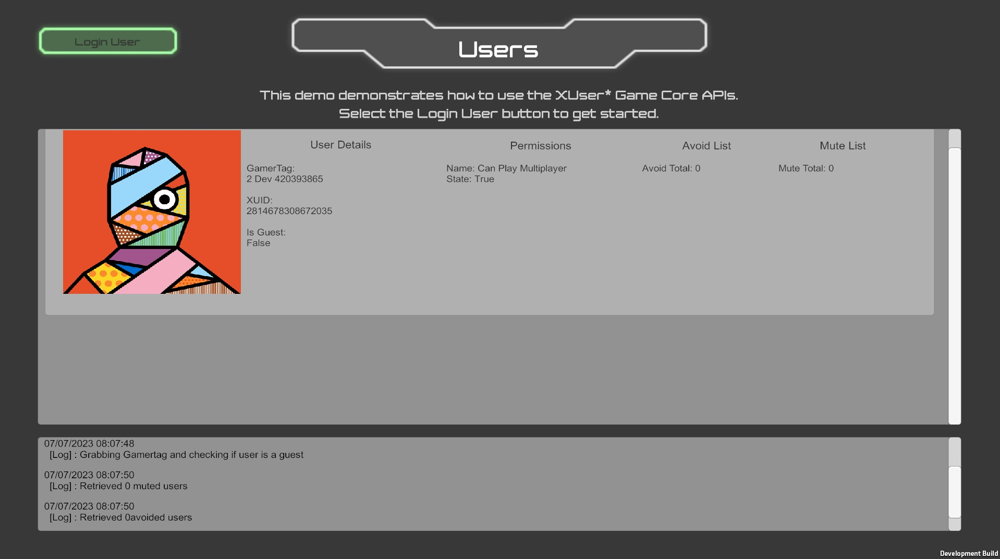

# Microsoft GDK Sample: Users

**Relevant areas:** Users

## Description

## Usage (without the com.unity.microsoft.gdk.tools package)
Whilst this sample can be built and run without having the Microsoft GDK Tools package (com.unity.microsoft.gdk.tools), it is a more manual process and will not work 'out of the box'. Using the Microsoft GDK API package (com.unity.microsoft.gdk) by itself is only recommended for those with that specific requirement.

1. Open the Unity Project and add the com.unity.microsoft.gdk package
2. From the Package Manager windows (`Unity Main Menu -> Window -> Package Manage`), selected the installed `Microsoft GDK` package, then from the `Samples` section install the sample
3. From the `Build Settings` window, `Windows` platform selected, add the sample scene and `build` to a target folder
4. In the `Project` window navigate to the recently installed sample folder which comes with pre-created Microsoft Game Config files. Manually copy the PC Microsoft Game Config (`Show in Explorer` from the context menu will help locate the file) to the resulting build folder where the built executable should now exist.
5. Rename the file copied in step 4 to `MicrosoftGame.config`
6. Ensure that the required GDK Assemblies are deployed to the build
7. Manually run the built executable

## Usage (with the com.unity.microsoft.gdk.tools package)
Using both the Microsoft GDK API (com.unity.microsoft.gdk) and Microsoft GDK Tools (com.unity.microsoft.gdk.tools) packages together is the recommended approach when developing for GDK. The tools package offers support that you do not get with the API package alone.

1. Open the Unity Project and add the com.unity.microsoft.gdk and com.unity,microsoft.gdk.tool packages
2. From the Package Manager windows (`Unity Main Menu -> Window -> Package Manage`), selected the installed `Microsoft GDK` package, then from the `Samples` section install the sample
3. In the `Project` window navigate to the recently installed sample folder, the sample comes with pre-created Microsoft Game Config and GDK Settings assets. Double click on the GDK Settings asset making it the currently active settings (or use `Unity Context Menu -> GDK -> Make GDK Settings Active`)
4. From the `Build Settings` window, with the `Windows` platform selected, add the sample scene then `Build & Run`

## Known Issues
See the `com.unity.microsoft.gdk` package CHANGELOG.md for known issues.